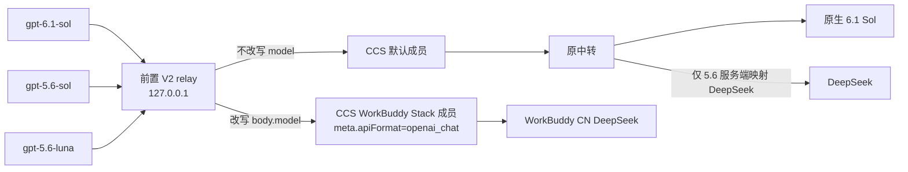

# WorkBuddy 三入口集成（0162）

状态：在 Codex CLI 0.162.0-alpha.17.2、CC Switch 4.0.8 和 WorkBuddy2API 1.13.0 的隔离环境中，44 项真实链路检查已通过。包含正式工具、普通父子协作、排队消息、跟进、强制上下文压缩、独立密文恢复和图像识别。每台机器仍须核验自己的正式配置，并正常重启桌面以加载新入口。

本文件描述 0.162 下三个模型入口的路由关系、配置边界、验收步骤和回滚思路。公开内容仅使用通用占位 URL、key 和路径，不包含用户实际 token 或本机路径。

## 1. 目标与边界

保留三个模型入口：

| 入口 | 路由 | 说明 |
| --- | --- | --- |
| `gpt-6.1-sol` | 原中转 | 原生 6.1 Sol，不经 DeepSeek 映射 |
| `gpt-5.6-sol` | 原中转 | 仅此入口在服务端映射 DeepSeek |
| `gpt-5.6-luna` | 前置 V2 relay → CCS → WorkBuddy | 新增 WorkBuddy CN DeepSeek 入口 |

必须保持：

- CodeMode；
- V2 多代理协议；
- 普通 in-session 协作。

本次不启用 CCS classic 子代理。启动器不修改系统二进制、不替换已安装 CLI、不编辑 `config.toml`、不重写历史；路由和 catalog 仅注入本次启动。

`gpt-6-luna` 是另一个既有模型，不等同于 `gpt-5.6-luna`。默认模型都经过 CCS 默认成员，`gpt-6-luna` 也不绕过 CCS。

## 2. 请求链



CCS 位于前置 relay 之后，必须保持运行。CCS 退出会使这次聚合启动的全部入口暂时不可用。默认模型都经过 CCS 默认成员；SOL 两条仍由 CCS 默认成员回到原中转，其中只有 5.6 Sol 在原中转服务端映射 DeepSeek，6.1 Sol 保持原生。

## 3. 组件职责

### 前置 V2 relay

- 只绑定 `127.0.0.1`，按请求 `body.model` 判断是否走新增路由。
- `gpt-5.6-luna`：把 `body.model` 改写为 `ccs-<CCS_REGISTERED_KEY>/cn:deepseek-v4.1-flash`。
- 只有 `model_routes` 中的别名改写 `body.model`；SOL 两条不改写。
- 对显式映射/别名请求，把 V2 `agent_message` 密文任务转为可读 user message；未列入 alias 的模型保持原 body/响应流转发到 CCS 默认成员，只有 `model_routes` 命中时才改写 `body.model`。
- 不负责 WorkBuddy 协议转码；该转码由 CCS Stack 成员完成。

### CCS

- 位于前置 relay 之后，是新增路由的下游聚合层。
- Stack 成员 `meta.apiFormat=openai_chat` 把 Responses/Chat 及工具调用转码到 WorkBuddy。
- 必须保持运行；退出会使新增路由不可用。
- 默认模型均经过 CCS 默认成员，`gpt-6-luna` 不绕过 CCS。
- 只启用 CodeMode、V2 和普通 in-session 协作，不启用 classic 子代理。

### 原中转

- 继续承载 `gpt-6.1-sol` 和 `gpt-5.6-sol`。
- `gpt-6.1-sol` 走原生 6.1 Sol，不经 DeepSeek 映射。
- 只有 `gpt-5.6-sol` 在原中转服务端映射 DeepSeek，不在 CCS 设置里新增映射。
- 旧密文恢复需要独立访问原中转的 HTTPS 和 key，见下文 `native_profile`。

### Catalog

- 用 `make-routed-catalog.py --workbuddy-model gpt-5.6-luna` 生成隔离 catalog；其他模型条目保持不变。
- 新增别名保留 Code Mode，并标记 V2、关闭 search tool / Responses-Lite 兼容开关；不要强制 `direct`，否则会隐藏桌面 `functions.exec`。

## 4. routes-config JSON v1

启动器默认读取与启动器同目录的 `routed-providers.local.json`；也可用 `--routes-config` 指定其他文件。支持字段：

- `version`：必须为 `1`。
- `upstream`：前置 relay 的下游地址，生产指向 CCS loopback。
- `model_routes`：别名→目标的显式映射；新增入口只放 `gpt-5.6-luna`。
- `native_profile`：独立 native 恢复配置的路径；相对路径按配置文件所在目录解析。

本文件不包含凭据。示例只使用占位符：

```json
{
  "version": 1,
  "upstream": "http://127.0.0.1:15721/v1",
  "model_routes": {
    "gpt-5.6-luna": "ccs-<CCS_REGISTERED_KEY>/cn:deepseek-v4.1-flash"
  },
  "native_profile": "private/native-profile.local.json"
}
```

`upstream` 指向 CCS。必须保留 `/v1` 路径段以匹配实际 Responses 路径拼接规则；端口 `15721` 只是示例，按实际设置替换。CCS 默认成员保存原中转的普通请求地址；独立恢复地址和凭据保存在私有的 `native_profile` 中。

## 5. native_profile 与旧密文恢复

`native_profile` 是私有 JSON，权限必须为 `0600`，不放入公开仓库：

```json
{
  "version": 1,
  "base_url": "https://<ORIGINAL_RELAY_HOST>/v1",
  "api_key": "<ORIGINAL_RELAY_KEY>",
  "provider_name": "OpenAI"
}
```

- 保存原中转 HTTPS 和 key，用于对旧 `agent_message` 密文做独立恢复。
- 必须与 CCS 的 loopback/占位鉴权分离；不要把 CCS 地址或 CCS 占位 key 写进 `native_profile`。
- 自动恢复要求两次独立读取结果一致，才写入私有恢复 map；不一致或不可读时请求失败，不修改历史。
- 恢复 map 同样保持私有，权限 `0600`，不要提交。
- routes-config 只保存 `native_profile` 的路径，不保存其中的 key。

## 6. 启动与退出

1. 正常退出当前 Codex 桌面；启动器会拒绝在原主进程仍在运行时再次启动。
2. 让启动器读取邻接的 `routed-providers.local.json`，或显式传入 `--routes-config`。
3. 启动器验证运行时版本、Code Mode V2 catalog、路由配置和恢复缓存。配置了 loopback CCS 路由时，`ensure-ccs-proxy.py` 检查端口；CCS 未运行则启动已安装的 `/usr/bin/cc-switch`，最多等待 30 秒。已有 CCS 进程但端口未就绪时，会报错并保留现有进程。`--check` 只验证文件，不启动 CCS。
4. 代理就绪后，启动器启动本地 relay，创建本次启动的临时 wrapper，并设置 `CODEX_CLI_PATH`。
5. 桌面必须正常退出并重启，才能读取新的隔离目录/包装器。
6. 启动器退出时清理其拥有的 relay 和临时 wrapper。已就绪的 CCS 保持运行。
7. `prepare-workbuddy-ccs.py` 只生成新的私有隔离目录，不修改正式配置或启动服务。正式接入时须增量合并相关配置，保留其他应用设置和提供商，不整库覆盖隔离测试数据库。

## 7. 验收

上线前至少执行：

```bash
python3 scripts/launch-routed-codex.py --check \
  --routes-config <PRIVATE_ROUTES_JSON>

python3 scripts/test-workbuddy-routes.py
python3 scripts/test-routed-v2-relay.py
python3 scripts/test-native-recovery-profile.py
python3 scripts/test-prepare-workbuddy-ccs.py
python3 scripts/test-ensure-ccs-proxy.py
```

当前已验证：30 项新增路由契约、17 项原回归、17 项 native pin、3 项隔离准备器回归及 6 项 CCS 启动助手测试。真实原版 app-server 的以下检查全部完成且无错误：

| 检查 | 实测耗时 | 结果 |
| --- | --- | --- |
| WorkBuddy 5.6 LUNA 正式 shell/patch/read 和强制压缩后继续 | 31.09 秒 | 通过 |
| 使用测试专用路由的全 5.6 SOL/max WorkBuddy 父子、排队及跟进 | 98.49 秒 | 通过 |
| 原生 6.1 SOL 经 CCS 默认成员，工具和压缩后继续 | 46.30 秒 | 通过 |
| 保留原中转映射的 5.6 SOL，工具和压缩后继续 | 28.43 秒 | 通过 |
| 原生 6.1 SOL → WorkBuddy 5.6 LUNA/max 子代理，排队及跟进 | 144.81 秒 | 通过 |
| 随机生成三色图片的 WorkBuddy 识别 | 3.12 秒 | 三个颜色全部正确 |

全 SOL 的测试专用映射不用于正式配置。跨提供商测试恢复了 3 条新密文，独立缓存和排队标记由验收程序核对；旧任务的冷缓存双读也通过。耗时是完整任务墙钟时间，不能据此推算 TPS。已验收原版 app-server 的普通 in-session 协作；桌面重启后是否加载新 catalog 需要另行核验。

CCS 4.0.8 的 Codex adapter 对 provider config 中带引号的 TOML `"base_url"` 存在读取限制。准备器同时写入该提供商 `settings_config.base_url`，以保证普通请求和压缩请求都能解析地址。已加入对应回归。CCS 的 V2 compaction 转换也已通过上述真实强制压缩检查。

正式配置中还验证了三条请求链：新交付启动器的 WorkBuddy shell/patch/read 验收完成于 21.42 秒；原生 6.1 SOL 与原映射 5.6 SOL 的随机校验串分别在 3.51 秒和 2.55 秒正确返回。启动助手真实启动正常 CCS 并建立 loopback 监听，已有服务时复用进程。准备器同步原来的默认模型和推理强度，避免 CCS 接管后移除原设置。

原生父代理发来的未缓存密文，每条需要原中转两次读取并核对一致；跨提供商任务因此会多出请求、延迟和可能的计费。缓存可避免重复恢复。CCS 显示未知模型成本为零并不代表服务免费；WorkBuddy 的完整 1M 上下文未做压力验收，客户端保留保守的 catalog 限制。

## 8. 回滚

- 正常退出 Codex 桌面。
- 在 CCS 中关闭 Codex 代理接管并恢复原中转提供商的 direct 配置；核验 `.codex/config.toml` 已回到原 HTTPS 地址，再改回原桌面启动方式。也可在 CCS 正常退出后恢复接入前的私有配置备份。
- 前置 relay 随启动器退出而停止；CCS 可按原方式停止。
- 新增 `gpt-5.6-luna` 路由随 relay/CCS 停止而不可用；恢复原 HTTPS 配置后，SOL 按原路径工作。
- 保留私有 routes-config、native_profile 和恢复 map，确认不再需要清理前不要删除。

## 9. 安全边界

公开内容只用占位符；私有配置和恢复 map 不入库，不与 CCS loopback/占位鉴权混用。恢复依赖原中转的兼容解密能力和有效凭据；本地缓存并非离线破解加密，原历史保持完整。

